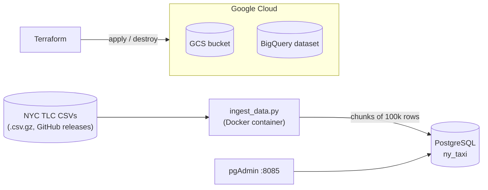

# Module 01 – Docker, SQL & Terraform

My Module 1 work for the **DataTalks.Club Data Engineering Zoomcamp (2026 cohort)**.

This module sets up the foundation for the rest of the project:
- a **containerized ingestion pipeline** that loads [NYC Taxi trip data](https://www.nyc.gov/site/tlc/about/tlc-trip-record-data.page) into PostgreSQL
- **Infrastructure as Code** with Terraform, provisioning the GCP resources used later in the course

---

## What Was Built

- **Python ingestion script** (`ingest_data.py`): downloads a month of yellow taxi data and loads it into Postgres in chunks. It has a CLI and is packaged as a Docker image.
- **Local database stack** in Docker Compose: PostgreSQL 18 and pgAdmin.
- **Jupyter notebook** (`notebook.ipynb`), where I explored the data and prototyped the load before turning it into a script.
- **Terraform config** (`terrademo/`): provisions a GCS bucket and a BigQuery dataset on GCP. I applied it, checked the resources in the GCP console, and destroyed it afterwards to avoid costs.

## Architecture



## Project Structure

```text
01-docker-terraform/
├── README.md
├── docker-sql/
│   └── pipeline/
│       ├── ingest_data.py        # ingestion CLI (the main script)
│       ├── Dockerfile            # image for the ingestion script
│       ├── docker-compose.yaml   # Postgres + pgAdmin
│       ├── docker_commands.sh    # Docker commands I used (networks, run, cleanup)
│       ├── notebook.ipynb        # data exploration and load prototype
│       ├── pipeline.py           # first Dockerfile exercise (toy script)
│       ├── pyproject.toml        # dependencies (managed with uv)
│       └── uv.lock
└── terraform-gcp/
    └── terrademo/
        ├── main.tf               # GCS bucket + BigQuery dataset
        ├── variables.tf          # project, region, names, credentials path
        └── .terraform.lock.hcl
```

## Data Ingestion

`ingest_data.py` does the following:

- Builds the download URL for the chosen year and month (`yellow_tripdata_YYYY-MM.csv.gz`)
- Reads the file in **chunks** (default 100,000 rows), so the whole month never has to fit in memory
- Uses **explicit data types** (nullable `Int64` for IDs and counts, parsed pickup/dropoff timestamps) instead of relying on pandas guessing them
- Creates the target table from the first chunk's schema, then appends each chunk, with a `tqdm` progress bar

Re-running it **replaces** the target table, so it isn't incremental. Module 2 solves that with staging tables and `MERGE`.

### CLI Options

| Option | Default | Description |
|---|---|---|
| `--pg-user` | `root` | PostgreSQL user |
| `--pg-pass` | `root` | PostgreSQL password |
| `--pg-host` | `localhost` | PostgreSQL host |
| `--pg-port` | `5432` | PostgreSQL port |
| `--pg-db` | `ny_taxi` | Database name |
| `--year` | `2021` | Year of the data |
| `--month` | `1` | Month of the data |
| `--chunksize` | `100000` | Rows per chunk |
| `--target-table` | `yellow_taxi_data` | Target table name |

## How to Run Locally

All commands are run from `01-docker-terraform/docker-sql/pipeline/`.

**1. Start Postgres and pgAdmin:**

```bash
docker compose up -d
```

pgAdmin is at http://localhost:8085 (login: `admin@admin.com` / `root`, local development defaults only).

**2. Build the ingestion image:**

```bash
docker build -t taxi_ingest:v001 .
```

**3. Run the ingestion** on the Compose network, so the container can reach Postgres by its service name `pgdatabase`:

```bash
docker run -it --rm \
  --network=pipeline_default \
  taxi_ingest:v001 \
    --pg-user=root \
    --pg-pass=root \
    --pg-host=pgdatabase \
    --pg-port=5432 \
    --pg-db=ny_taxi \
    --target-table=yellow_taxi_trips \
    --year=2021 \
    --month=1
```

Or run it without Docker, using uv:

```bash
uv run python ingest_data.py --year=2021 --month=1 --target-table=yellow_taxi_trips
```

## Terraform (GCP)

`terrademo/main.tf` defines:

- a **GCS bucket** named `<project>-terrabucket-01`, with a lifecycle rule that aborts incomplete multipart uploads after 1 day and `force_destroy` enabled so `terraform destroy` can delete it even when it isn't empty
- a **BigQuery dataset** `demo_dataset`

Both are in the `EU` location. The values are defined in `variables.tf`.

### Running it

1. Create a GCP service account with the **Storage Admin**, **BigQuery Admin** and **Compute Admin** roles, and download its JSON key.
2. Save the key as `terrademo/credentials/google-account-keys.json`. This path is **git-ignored**.
3. From `terraform-gcp/terrademo/`, run:

```bash
terraform init
```

```bash
terraform plan
```

```bash
terraform apply
```

```bash
terraform destroy
```

State files (`*.tfstate`) and `.terraform/` are git-ignored too.

## Key Learnings

- Docker makes the environment reproducible. The database, admin tool and ingestion script all run the same way on any machine.
- Containers on the same Docker network reach each other by **service name** (`pgdatabase`), not `localhost`.
- Explicit schemas and chunked loading matter as soon as data stops fitting comfortably in memory.
- Prototyping in a notebook and then moving to a parameterized script is a practical workflow.
- With Terraform, the config describes the infrastructure, and `plan` shows what will change before `apply` changes it. `destroy` makes cleanup safe and repeatable.
- Never commit data, credentials, state files or virtual environments.
