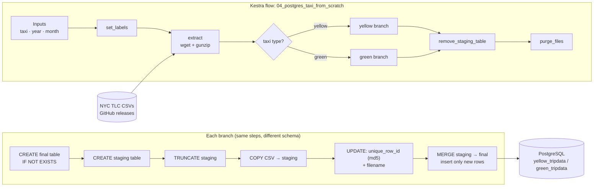

# Module 02 – Workflow Orchestration (Kestra)

My Module 2 work for the **DataTalks.Club Data Engineering Zoomcamp (2026 cohort)**.

This module moves the Module 1 ingestion from a one-off script to an **orchestrated, parameterized, idempotent pipeline** in [Kestra](https://kestra.io). It loads monthly NYC Taxi trip data (yellow and green) into PostgreSQL.

---

## What Was Built

- A local Kestra stack in Docker Compose: Kestra, its own Postgres backend, the `ny_taxi` Postgres database and pgAdmin.
- `04_postgres_taxi_from_scratch.yaml`: an end-to-end ELT flow I wrote **step by step myself** instead of copying the course solution (`04_postgres_taxi.yaml`, kept for reference).
- Database credentials stored as **Kestra secrets** instead of being hardcoded in the flow.

## Pipeline Architecture



## Design Decisions

| Decision | Why |
|---|---|
| **Load into a staging table, then `MERGE` into the final table** | Makes the flow **idempotent**: re-running the same month inserts no duplicate rows. Only rows whose `unique_row_id` isn't already in the final table are inserted. |
| **`unique_row_id` = md5 of identifying columns** | The source data has no natural primary key. Hashing vendor, pickup/dropoff times, locations, fare and distance gives a deterministic row identity. |
| **`PRIMARY KEY` on `unique_row_id` in the final table** | Creates an index, so the `MERGE` join doesn't scan the whole final table on every load. It also enforces uniqueness at the database level. |
| **`filename` column** | Lineage: every row records which monthly file it came from. |
| **Drop the staging table at the end** | Staging is temporary. Removing it saves storage. |
| **`concurrency: limit 1, behavior: QUEUE`** | All runs for one taxi type share one staging table. Two parallel runs would overwrite each other's staging data, so extra runs wait in a queue. |
| **`pluginDefaults` for the Postgres connection** | Defines the connection once instead of repeating it in every SQL task. |
| **Credentials via `{{ secret(...) }}`** | No passwords in the flow file. Values come from a git-ignored `.env_encoded` file. |
| **Execution labels (`file`, `taxi`)** | Makes runs easy to find and filter in the Kestra UI. |
| **Separate yellow / green branches** | The two datasets have different schemas (`tpep_*` vs `lpep_*` timestamps, plus extra green columns like `ehail_fee` and `trip_type`). |

## Flows in This Folder

| Flow | What it covers |
|---|---|
| `01_hello_world.yaml` | Kestra basics: inputs, variables, outputs, concurrency limits |
| `02_python.yaml` | Running a Python script in a Docker task runner, producing outputs and metrics |
| `03_getting_started_data_pipeline.yaml` | A simple extract → transform → query pipeline |
| `04_postgres_taxi.yaml` | Course reference solution |
| `04_postgres_taxi_from_scratch.yaml` | **My own implementation** (described above) |

## How to Run Locally

**1. Create the secrets.** In `02-workflow-orchestration/`, create a `.env` file (it's git-ignored):

```bash
POSTGRES_USERNAME=root
POSTGRES_PASSWORD=root
```

Kestra (open-source edition) reads secrets from `SECRET_`-prefixed, base64-encoded environment variables. Generate `.env_encoded` (also git-ignored) from it:

```bash
while IFS='=' read -r key value; do
    echo "SECRET_$key=$(echo -n "$value" | base64)";
done < .env > .env_encoded
```

**2. Start the stack:**

```bash
docker compose up -d
```

| Service | URL |
|---|---|
| Kestra UI | http://localhost:8080 (login set in `docker-compose.yaml`) |
| pgAdmin | http://localhost:8085 |
| Postgres (`ny_taxi`) | `localhost:5432` |

**3. Run the flow.** In the Kestra UI, create a new flow and paste in `flows/04_postgres_taxi_from_scratch.yaml`. Then click **Execute** and pick the taxi type, year and month.

> The credentials in `docker-compose.yaml` are local development defaults only.

## What I'd Improve Next

- **Remove the yellow/green duplication.** The two branches share the same logic, so the schema-specific parts could be moved into variables or subflows.
- **Data quality checks.** For example, row counts staged vs. merged, null checks on timestamps, and failing the run on anomalies.
- **Deduplicate inside staging before `MERGE`.** Identical rows within one file share the same `unique_row_id`, which would conflict with the primary key.

## Key Learnings

- Orchestration is more than scheduling. It covers parameterization, retries, concurrency, lineage and observability.
- Idempotency has to be designed in from the start, with staging tables, deterministic keys and merges.
- Keeping secrets out of code applies to pipeline definitions too, not just application code.
