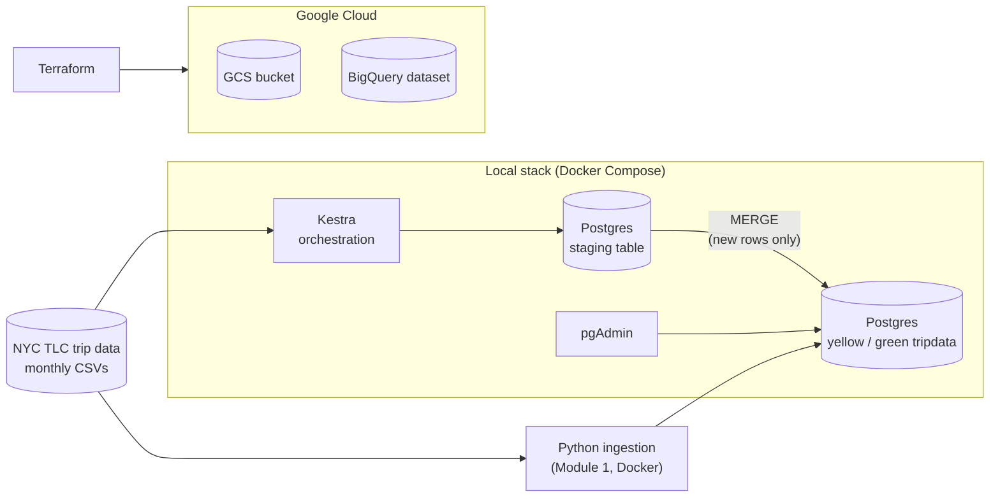
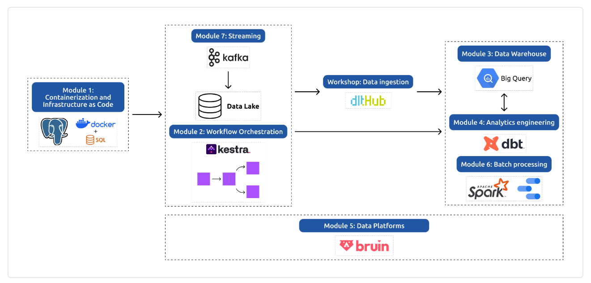

# 🚕 NYC Taxi Data Platform — Data Engineering Zoomcamp

I'm building an end-to-end data platform on **NYC Taxi trip data** as I work through the [DataTalks.Club Data Engineering Zoomcamp](https://github.com/DataTalksClub/data-engineering-zoomcamp) (2026 cohort).

**Today**, it's a containerized, orchestrated pipeline. It downloads monthly taxi data, loads it into PostgreSQL **idempotently** with Kestra, and provisions cloud infrastructure on GCP with Terraform.
**Next**, it moves to the cloud: a data lake and BigQuery warehouse, dbt models, batch processing with Spark and streaming with Kafka.

---

## Current Architecture



## Skills Demonstrated

- **Containerization:** Dockerized Python ingestion and multi-service Docker Compose stacks (Postgres, pgAdmin, Kestra)
- **Data ingestion:** chunked loading with explicit schemas, so large files don't have to fit in memory
- **Workflow orchestration:** parameterized Kestra flows (taxi type, year, month), conditional branches, execution labels, concurrency control
- **Idempotent loads:** staging tables, deterministic row IDs (md5 hash) and `MERGE`, so re-running a load never creates duplicates
- **SQL & data modeling:** table design, primary keys and indexing, handling two datasets with different schemas
- **Secrets management:** credentials kept out of code and git, using Kestra secrets and git-ignored key files
- **Infrastructure as Code:** Terraform for GCS and BigQuery, with the full `plan` → `apply` → `destroy` lifecycle

## Progress

| Module | Topic | Status | Notes |
|---|---|---|---|
| 1 | Containerization & Infrastructure as Code: Docker, Postgres, Terraform | ✅ Done | [01-docker-terraform](./01-docker-terraform) |
| 2 | Workflow Orchestration: Kestra | ✅ Done | [02-workflow-orchestration](./02-workflow-orchestration) |
| Workshop | Data Ingestion: dlt | ⏳ Planned | |
| 3 | Data Warehouse: BigQuery | ⏳ Planned | |
| 4 | Analytics Engineering: dbt | ⏳ Planned | |
| 5 | Data Platforms: Bruin | ⏳ Planned | |
| 6 | Batch Processing: Spark | ⏳ Planned | |
| 7 | Streaming: Kafka | ⏳ Planned | |
| — | Final project | ⏳ Planned | |

Each module folder has its own README covering what I built, the design decisions and how to run it.

## Tech Stack

| Area | Tools |
|---|---|
| Languages | Python, SQL |
| Containers | Docker, Docker Compose |
| Databases | PostgreSQL, pgAdmin |
| Orchestration | Kestra |
| Infrastructure as Code | Terraform |
| Cloud | Google Cloud Platform (GCS, BigQuery) |
| Python tooling | uv, pandas, SQLAlchemy, Jupyter |
| Version control | Git, GitHub |

## Repository Structure

```text
.
├── 01-docker-terraform/         # Module 1: Docker, Postgres ingestion, Terraform on GCP
│   ├── docker-sql/pipeline/     #   Python ingestion script + Docker setup
│   └── terraform-gcp/terrademo/ #   GCS bucket + BigQuery dataset
├── 02-workflow-orchestration/   # Module 2: Kestra stack and flows
│   └── flows/                   #   04_postgres_taxi_from_scratch.yaml is my main pipeline
└── images/                      # diagrams used in the READMEs
```

## Course Roadmap

The course curriculum, which this project follows (image from DataTalks.Club):


