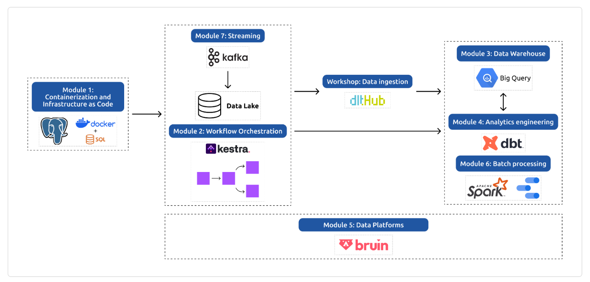

# 🚕 NYC Taxi Data Platform — Data Engineering Zoomcamp

## PROJECT OVERVIEW

This project is being developed as part of the DataTalks.Club Data Engineering Zoomcamp, a hands-on course covering data engineering fundamentals such as: containerization, workflow orchestration, data warehousing, analytics engineering, batch processing, and streaming.

Using NYC Taxi trip data as a unifying dataset, the project is to incrementally evolve from a local, containerized ingestion pipeline into a cloud-based, orchestrated, analytics-ready data platform.

---

## ARCHITECTURE DIAGRAM

Complete Data Engineering Zoomcamp curriculum: from infrastructure setup to stream processing.

---

## Technologies Used

### Core
- Docker
- PostgreSQL
- Python
- Terraform

### Orchestration 
- Kestra

### Tooling
- Git
- GitHub

---

## Project Structure Breakdown 

### Module 1 — Docker, SQL & Terraform
- Dockerized PostgreSQL and pgAdmin
- Python-based ingestion pipeline
- Terraform fundamentals (init & project structure)

📁 [`01-docker-terraform`](./01-docker-terraform)
📝 [notes →](./01-docker-terraform/README.md)

### Module 2 — Workflow Orchestration (Kestra)

📁 [`02-workflow-orchestration`](./02-workflow-orchestration)
📝 [notes →](./02-workflow-orchestration/README.md)
